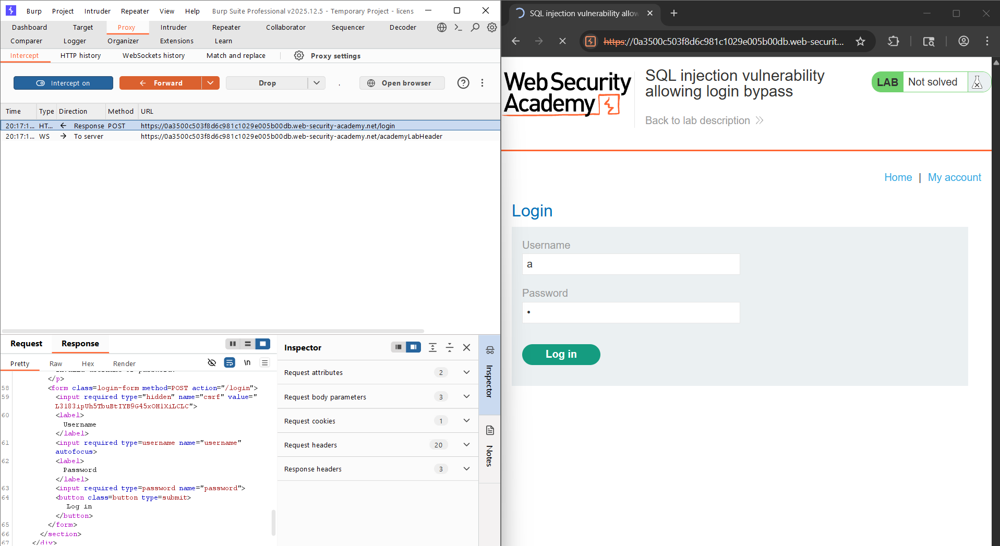
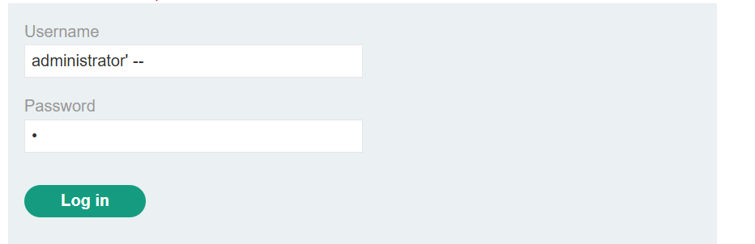
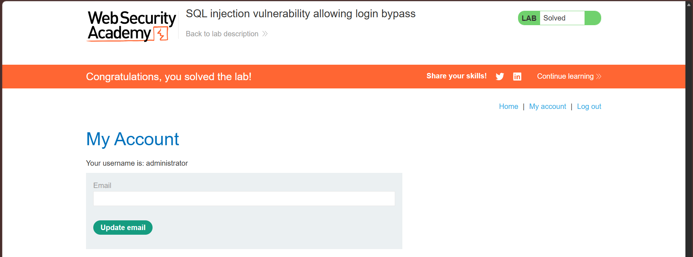

>This lab contains a SQL injection vulnerability in the login function.
>
>To solve the lab, perform a SQL injection attack that logs in to the application as the `administrator` user.

Ở bài này nhiệm vụ của mình là phải bypass thành công trang đăng nhập để vào được tài khoản có tên la administrator. Đầu tiên ta thử đại 1 cái username = a và password = a để xem cách server sẽ phản hồi về như thế nào để xác định chắc chắn là nó vẫn sẽ truy xuất database để duyệt đăng nhập.

Ta nhận thấy phương thức gửi sẽ là POST với username = a và password = a. Thì nó sẽ dò kết quả trong bảng database có trước với câu lệnh được dự đoán sẽ là: 

`SELECT * FROM users WHERE username = 'a' AND password = 'a'`

Nếu không có bất cứ cơ chế lọc nào thì ta hoàn toàn có thể vào được administrator mà không cần phải biết mật khẩu ta có thể tìm cách để bỏ phần kiểm tra mật khẩu như sau: Ta sẽ thử đặt username là administrator'-- thì đoạn SQL sẽ trở thành:

`SELECT * FROM users WHERE username = 'administrator' -- AND password = 'a'

Hoàn toàn hợp lệ vì nếu ta để như thế này thì rõ ràng phần mật khẩu sẽ nằm sau phần comment trong truy vấn SQL khiến nó không còn là 1 điều kiện nữa.

Lúc này ta đã thành công bypass vào tài khoản administrator mà không cần phải biết mật khẩu:

